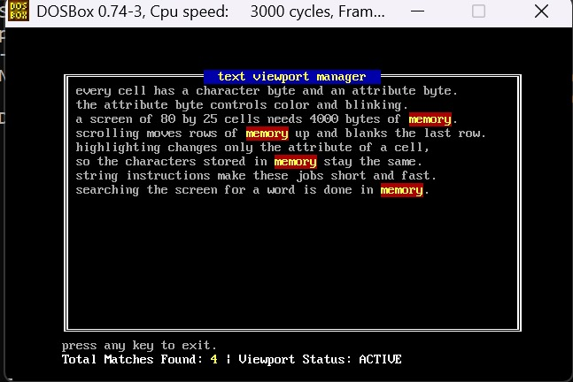
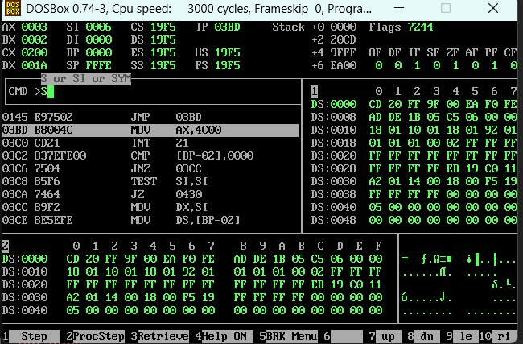

# COAL - Programs

**Name:** Muhammad Huzaifa Chaudhary
**Roll No:** L250700
**Course:** Computer Organization & Assembly Language (COAL)

## Description

This repository contains my 16-bit 8088 assembly language programs for the COAL course. Each assignment is kept in its own folder.

### Assignment 3 - Text Viewport Manager with Windowed Scrolling & Live Keyword Highlighter

A text-mode program that works directly on video memory (segment 0xB800):

- Clears the 80x25 screen and draws a double-line bordered window (rows 3 to 21, columns 8 to 72) with a centered title banner (attribute 0x1E, yellow on blue).
- Streams a multi-line text document into the window using LODSB and STOSW, with left and right margins of 2 columns.
- `scroll_window_up` scrolls only the text inside the window using MOVSW row by row, then blanks the vacated rows with STOSW. The borders and the rest of the screen are not touched.
- `find_and_highlight` searches the viewport for a keyword using CMPSB and changes only the attribute bytes (0xCE, blinking yellow on red) of every match, leaving the characters unchanged.
- Row 23 shows the status bar `Total Matches Found: [Count] | Viewport Status: ACTIVE`, where the count is printed by the stack-based `printNum` subroutine.
- Every subroutine receives its parameters through the stack, uses BP-relative addressing, keeps its local variables on the stack, preserves the registers it modifies and cleans up with `ret n`.

### Assignment 2

Assembly language programs for Assignment 2. A screenshot of the code is included below.

## Tools Used

- NASM (Netwide Assembler)
- DOSBox
- Notepad++
- Git and GitHub

## How to Assemble and Run

Assemble the program with NASM:

```
nasm qno2.asm -f bin -o qno2.com
```

Then run it in DOSBox:

```
mount c C:\path\to\L250700_assignmnetNo3
c:
qno2.com
```

Press a key once to scroll the window up, and press a key again to exit.

## Folder Structure

```
COAL-Programs/
|-- README.md
|-- l250700_assignmentNo2/
|   `-- codepic_qno4.jpeg
`-- L250700_assignmnetNo3/
    |-- qno2.asm
    `-- pic1.jpeg
```

## Output Screenshots

### Assignment 3



### Assignment 2


